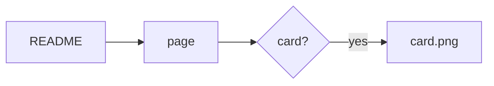
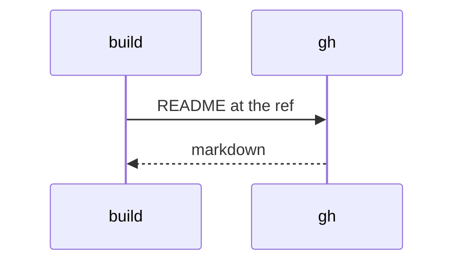

# Fixture app

[](https://example.com/ci) A README that uses every feature the
build renders; `test/golden.test.ts` builds it offline and compares every byte.

> [!NOTE]
> An alert, with **bold** and a [relative link](docs/guide.md#start).

Text between two alerts.

> [!CAUTION]
> A second kind.

A footnote[^why] and ~~struck~~ text, and a bare link: https://example.com.

[^why]: Footnotes render at the end.

- [x] a done task
- [ ] a task to do

| Language | Highlighted |
| -------- | ----------- |
| Go       | yes         |
| Clojure  | yes         |

```go
func main() { fmt.Println("hi") }
```

```clojure
(defn greet [name] (str "hi " name))
```

```toml
[tool]
name = "fixture"
```






<picture>
  <source media="(prefers-color-scheme: dark)" srcset="./docs/dark.png">
  
</picture>

<!-- a comment stays -->

## Star History

[](https://star-history.com/#o/app)

## Dropped

This section is named in the fixture's drop list.

## Licence

MIT
